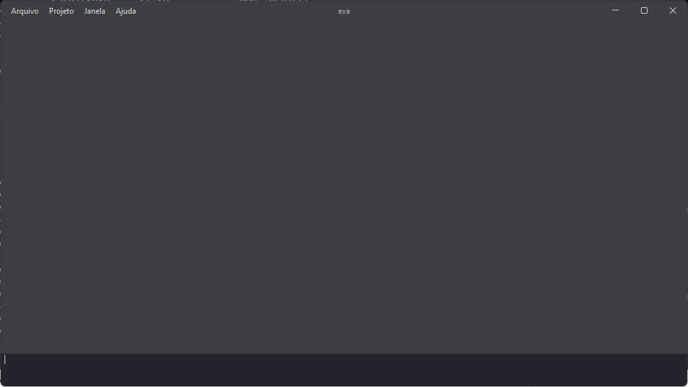
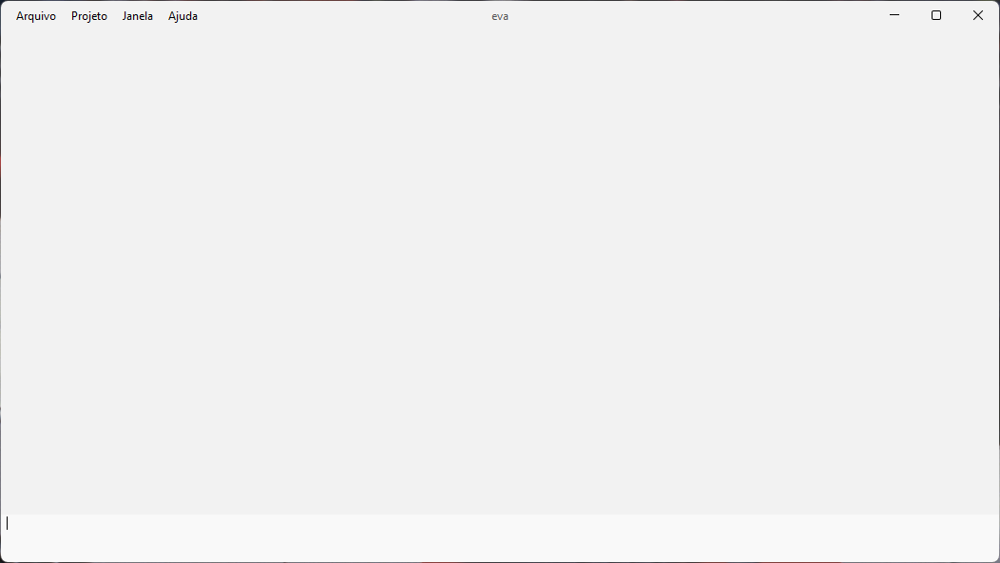
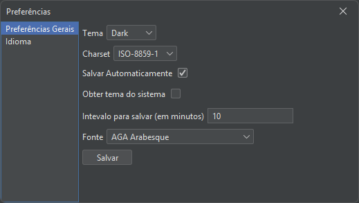
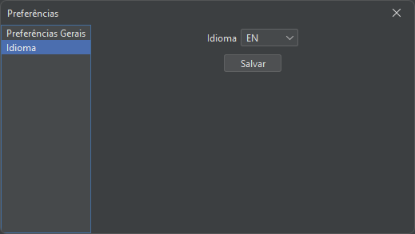

# eva

<p>
  
  
  
  
  
</p>

Eva is a lightweight code editor written entirely in Java (Swing + [FlatLaf](https://www.formdev.com/flatlaf/)). It is designed to be simple and fast: open a file, edit it, and compile or run it without leaving the editor. The output shows up in a built-in output panel.

> [!IMPORTANT]
> This project is a work in progress. Contributions and feedback are welcome!

---

## Table of Contents

- [Screenshots](#screenshots)
- [Features](#features)
- [Getting Started](#getting-started)
- [Usage](#usage)
- [Keyboard Shortcuts](#keyboard-shortcuts)
- [Configuration](#configuration)
- [Localization](#localization)
- [Project Structure](#project-structure)
- [Architecture Overview](#architecture-overview)
- [Known Limitations](#known-limitations)
- [Contributing](#contributing)
- [License](#license)

---

## Screenshots

| Main window (dark theme) | Main window (light theme) |
| :---: | :---: |
|  |  |

| Multiple tabs | Output panel (compile / run) |
| :---: | :---: |
|  |  |

| Preferences - General | Preferences - Language |
| :---: | :---: |
|  |  |

---

## Features

- **Tabbed editing**: open multiple files at once, each in its own tab. Opening a file that is already open switches to its tab.
- **Unsaved changes indicator**: modified tabs are marked with a `*` until saved.
- **Compile & run from the editor**: compile Java, C and C++ files, and run Java, Python and Julia files. Output and errors appear in the output panel.
- **Keyword highlighting**: Java keywords are highlighted in bold blue as you type.
- **Auto-closing brackets**: `(` inserts `)`, `[` inserts `]`, and `{` followed by <kbd>Enter</kbd> inserts a closing `}`.
- **Undo**: basic character-level undo with <kbd>Ctrl</kbd> + <kbd>Z</kbd>.
- **Dark & light themes**: powered by FlatLaf. Eva can follow the Windows theme automatically.
- **Preferences dialog**: change theme, charset, auto-save, editor font and language.
- **Localized UI**: English and Brazilian Portuguese.
- **Timestamped log**: file actions (open, save, compile) are logged in the output panel with the time they happened.

---

## Getting Started

### Prerequisites

- **Windows** 10 or 11
- **Java Development Kit (JDK) 17** or higher
- **Maven 3.5.0** or higher

### Installation

1. Clone this repository:
   ```bash
   git clone https://github.com/wiirios/eva.git
   ```
2. Go to the project directory:
   ```bash
   cd eva
   ```
3. Compile the project:
   ```bash
   mvn clean compile
   ```
4. Copy the dependencies (FlatLaf, Commons Configuration) to `target/dependency`:
   ```bash
   mvn dependency:copy-dependencies
   ```
5. Run Eva:
   ```bash
   java -cp "target/classes;target/dependency/*" org.william.eva.Main
   ```

> [!IMPORTANT]
> Always start Eva from the **project root folder**. The editor reads its settings from `./src/main/resources/config.properties` using a relative path.

> [!TIP]
> On JDK 22 or newer you may see a `WARNING: A restricted method in java.lang.System has been called` message from FlatLaf. It is harmless. To hide it, add `--enable-native-access=ALL-UNNAMED`:
> ```bash
> java --enable-native-access=ALL-UNNAMED -cp "target/classes;target/dependency/*" org.william.eva.Main
> ```

---

## Usage

1. **Open a file**: `File → Open` (<kbd>Ctrl</kbd> + <kbd>O</kbd>). The file opens in a new tab.
2. **Edit**: type as usual. The tab title gets a `*` while there are unsaved changes.
3. **Save**: `File → Save` (<kbd>Ctrl</kbd> + <kbd>S</kbd>) opens a save dialog where you choose the target file.
4. **Compile**: `Project → Compile` (<kbd>Ctrl</kbd> + <kbd>B</kbd>). If it succeeds, you see `The compilation was successful`. Otherwise the compiler errors appear in the output panel.
5. **Run**: `Project → Run` (<kbd>Ctrl</kbd> + <kbd>R</kbd>). The program output (or its error output) appears in the output panel.
6. **Close a tab**: `File → Close Tab` (<kbd>Ctrl</kbd> + <kbd>W</kbd>).
7. **Preferences**: `Window → Preferences` (<kbd>Ctrl</kbd> + <kbd>Alt</kbd> + <kbd>P</kbd>). Restart Eva to apply changes.

> [!NOTE]
> Programs run until they exit, and the output is shown only after that. Interactive programs (that read from `stdin`) are not supported yet.

---

## Keyboard Shortcuts

| Shortcut | Action |
| --- | --- |
| <kbd>Ctrl</kbd> + <kbd>O</kbd> | Open file |
| <kbd>Ctrl</kbd> + <kbd>S</kbd> | Save file |
| <kbd>Ctrl</kbd> + <kbd>W</kbd> | Close current tab |
| <kbd>Ctrl</kbd> + <kbd>B</kbd> | Compile current file |
| <kbd>Ctrl</kbd> + <kbd>R</kbd> | Run current file |
| <kbd>Ctrl</kbd> + <kbd>Z</kbd> | Undo last typed character |
| <kbd>Ctrl</kbd> + <kbd>Alt</kbd> + <kbd>P</kbd> | Open Preferences |
| <kbd>Ctrl</kbd> + <kbd>Alt</kbd> + <kbd>G</kbd> | Open the GitHub page |

---

## Configuration

Settings are stored in [`src/main/resources/config.properties`](src/main/resources/config.properties). Most of them can be changed from the Preferences dialog, or you can edit the file directly.

| Key | Default | Description |
| --- | --- | --- |
| `theme` | `Dark` | `Dark` or `Light`. Used when `getthemefromsystem` is `false`. |
| `getthemefromsystem` | `true` | Follow the Windows light/dark app theme (read from the Registry). |
| `charset` | `ISO-8859-1` | Charset used to read system command output. |
| `autosave` | `true` | Auto-save option (saving before *Run* is still in progress). |
| `autosaveinterval` | `10` | Auto-save interval in minutes. |
| `editorfont` | — | Editor font family (selectable in Preferences). |
| `editorfontsize` | `14` | Editor font size. |
| `editorstyle` | `PLAIN` | Editor font style. |
| `terminalfont` | `Courier New` | Output panel font family. |
| `terminalfontsize` | `12` | Output panel font size. |
| `terminalstyle` | `PLAIN` | Output panel font style. |
| `fullerrorlog` | `false` | When `true`, show the full stack trace when a file cannot be read. |
| `lang` | `EN` | Preferred language (`EN` or `PT`). |
| `getlanguagefromsystem` | `true` | Use the operating system language. |

> [!NOTE]
> Some settings are saved but not used by the UI yet (for example the font settings and `lang`). See [Known Limitations](#known-limitations).

---

## Localization

UI strings live in resource bundles in `src/main/resources`:

| File | Language |
| --- | --- |
| `lang_en_US.properties` | English (default) |
| `lang_pt_BR.properties` | Português (Brasil) |

The language is chosen from the Windows display language. To add a new language, create a `lang_<language>_<COUNTRY>.properties` file with the same keys as `lang_en_US.properties`.

---

## Project Structure

```
eva/
├── pom.xml                         # Maven build (Java 17, FlatLaf, Commons Configuration, JUnit 5)
├── docs/screenshots/               # Screenshots used in this README
└── src/
    ├── main/
    │   ├── java/org/william/eva/
    │   │   ├── Main.java           # Entry point; starts the Swing UI
    │   │   ├── annotation/
    │   │   │   └── Incomplete.java # Marks methods that are still in progress
    │   │   ├── input/
    │   │   │   ├── KeyAction.java  # Open / save / run / compile actions
    │   │   │   ├── Stack.java      # Fixed-size character stack (max 50) used by Undo
    │   │   │   └── Undo.java       # Ctrl+Z character undo
    │   │   ├── io/
    │   │   │   ├── Config.java     # Reads/writes config.properties, detects Windows theme
    │   │   │   ├── Message.java    # Enum of log messages shown in the output panel
    │   │   │   ├── Terminal.java   # Formats timestamped log and error entries
    │   │   │   └── file/
    │   │   │       ├── FileEntity.java   # File model (name, extension, path, size)
    │   │   │       └── FileManager.java  # File chooser helpers and file reading
    │   │   ├── runtime/
    │   │   │   ├── Compiler.java   # Runs javac / gcc / g++ in a background thread
    │   │   │   └── Runner.java     # Runs java / python / julia in a background thread
    │   │   ├── ui/
    │   │   │   ├── Frame.java      # Main window, menus, syntax highlighting, auto-close
    │   │   │   ├── Dialog.java     # Preferences dialog
    │   │   │   └── TabManager.java # Tabs, modified/saved state
    │   │   └── util/
    │   │       └── Resources.java  # Loads the localized resource bundles
    │   └── resources/
    │       ├── config.properties
    │       ├── lang_en_US.properties
    │       └── lang_pt_BR.properties
    └── test/java/org/william/eva/
        └── MainTest.java
```

---

## Architecture Overview

```
 Main ──▶ Frame (JFrame + menus)
            │
            ├── TabManager ──▶ one JTextPane per open file
            │
            ├── KeyAction ──┬──▶ FileManager / FileEntity   (open, save)
            │               ├──▶ Compiler  ──▶ cmd.exe /c javac|gcc|g++ <file>
            │               └──▶ Runner    ──▶ cmd.exe /c java|python|julia <file>
            │                         │
            │                         ▼
            ├── Output panel ◀── Terminal (timestamped logs) + process output
            │
            ├── Dialog (Preferences) ──▶ Config ──▶ config.properties
            └── Resources ──▶ lang_*.properties
```

- **`Frame`** builds the window, applies the FlatLaf theme and wires each menu item to an action.
- **`KeyAction`** handles user actions. It finds the current file from `TabManager`, checks the file extension, and starts a `Compiler` or `Runner`.
- **`Compiler` / `Runner`** implement `Runnable`. Each one starts a `cmd.exe` process in the file's folder and collects its output for the output panel.
- **`Config`** wraps `config.properties` (read with `java.util.Properties`, written with Apache Commons Configuration). It also reads `AppsUseLightTheme` from the Windows Registry.

---

## Known Limitations

- Windows only (see the note at the top).
- Eva must be started from the project root, because it reads `config.properties` with a relative path.
- Syntax highlighting uses the **Java** keyword list for every supported file type.
- *Run* is not available for C/C++ yet. Compile them, then run the generated executable yourself.
- Programs that wait for user input (`stdin`) are not supported. Output is shown after the process ends.
- Undo only removes the last typed characters (up to 50). There is no redo yet.
- Font, font size and `lang` settings are saved but not applied by the UI yet.

---

## Contributing

Contributions are welcome!

1. Fork the repository.
2. Create a branch: `git checkout -b feat/my-feature`
3. Commit your changes using [Conventional Commits](https://gist.github.com/qoomon/5dfcdf8eec66a051ecd85625518cfd13) (for example `feat: ...`, `fix: ...`, `docs: ...`).
4. Push the branch and open a Pull Request.

Found a bug or have an idea? [Open an issue](https://github.com/wiirios/eva/issues).

---

## MIT License

This project is licensed under MIT license, read more at <span><a href="https://docs.github.com/pt/repositories/managing-your-repositorys-settings-and-features/customizing-your-repository/licensing-a-repository">docs.github</span>
